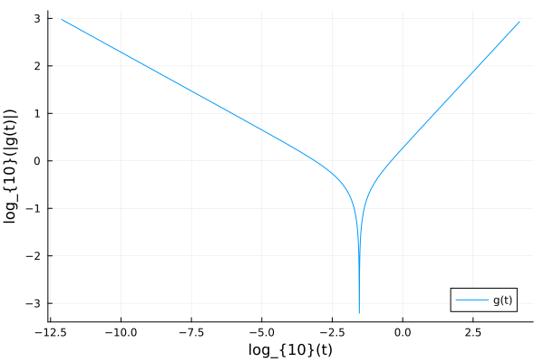

# MCTBetaScaling.jl
[](https://github.com/IlianPihlajamaa/MCTBetaScaling.jl/actions)
[](https://IlianPihlajamaa.github.io/MCTBetaScaling.jl/stable)
[](https://IlianPihlajamaa.github.io/MCTBetaScaling.jl/dev)

Asymptotic analysis of mode-coupling theory (MCT) near the glass transition, built on
[ModeCouplingTheory.jl](https://github.com/IlianPihlajamaa/ModeCouplingTheory.jl):

- solvers for the β-scaling equation and for its stochastic extension, stochastic β-relaxation (SBR);
- the parameters of these equations computed from the static structure factor `S(k)`: the exponent parameter `λ`, the separation parameter `σ = Cε`, the variance `Δσ²` of its quenched fluctuations, and the gradient coefficient `Γ`.

## Beta-scaling equation

The beta-scaling model is implemented to make it easier to find critical exponents of MCT. The equation is

$$\sigma - \delta t + \lambda (g(t))^2 = \partial_t∫g(t-\tau)g(\tau)d\tau.$$

Here, $\sigma$ is the distance from the critical point, $\lambda$ is the relevant eigenvalue of the stability matrix. $g(t)$ describes the deviation of the order parameter from the plateau. $\delta$ is an optional hopping parameter, defaulting to 0 if not specified. Each of the parameters have to be floating point numbers.

### Example
In order to solve the beta-scaling equation, we have to specify the parameters defining the equation and a time-scale `t0` that shifts the results.
```julia
using ModeCouplingTheory, MCTBetaScaling, Plots
λ = 0.7; ϵ = -0.1; t0 = 0.001
equation = BetaScalingEquation(λ, ϵ, t0)
sol = solve(equation, TimeDoublingSolver(t_max=10^4.))
plot(log10.(sol.t), log10.(abs.(sol.F)), ylabel="log_{10}(|g(t)|)", xlabel="log_{10}(t)", label="g(t)")
```



In the figure, the slopes of the straight lines are given by the parameters $-a$ and $b$, which describe the relaxation towards and away from the plateau value of the correlator. These exponents are automatically computed, and are stored in `equation.coeff.a` and `equation.coeff.b`.

## Stochastic beta-relaxation (SBR)

SBR turns $\sigma$ into quenched disorder and adds a gradient term:

$$\sigma(x) - \delta t + \lambda (g(x,t))^2 + \alpha \nabla^2 g(x,t) = \partial_t∫g(x,t-\tau)g(x,\tau)d\tau.$$

`StochasticBetaScalingEquation` solves it on a periodic hypercubic lattice in any dimension (equal size and number of sites along every axis):

```julia
using ModeCouplingTheory, MCTBetaScaling
λ, α, t₀ = 0.75, 0.1, 0.001
Ls = (100.0, 100.0)                                   # physical size along each axis
ns = (100, 100)                                       # lattice sites along each axis
σ  = sqrt(3 * 0.01) .* (2 .* rand(prod(ns)) .- 1)     # uniform, variance 0.01
equation = StochasticBetaScalingEquation(λ, α, σ, t₀, Ls, ns)
sol = solve(equation, TimeDoublingSolver(t_max=10^10., Δt=1e-12, N=64, tolerance=1e-10))
g = get_F(sol, :, 1)                                  # g(t) at site 1
```

## Parameters from MCT

For a one-component system, the plateau of the MCT equations and the critical eigenvectors of its stability matrix give:

| Function | Quantity |
|---|---|
| `compute_lambda` | exponent parameter `λ`; `compute_lambda_multicomponent` for mixtures |
| `compute_C` | `C` in `σ = Cε`, `ε = (n - n_c)/n_c` |
| `compute_mu`, `compute_DeltaSigma2` | variance `Δσ² = μ² n_c S(0)` of the quenched fluctuations of `σ` |
| `compute_gamma` | gradient coefficient `Γ`, the `α` of SBR |

They take a `dDimModeCouplingKernel` from ModeCouplingTheory.jl and the normalized plateau `f(k) = F∞(k)/S(k)`; `compute_lambda` and `compute_gamma` also accept a `BipolarMCTKernel`, and `compute_lambda_multicomponent` takes the multicomponent kernel. See the docstrings for the exact arguments. 

### Γ and the dynamic correlation length

`Γ` is the `q²` coefficient of the top eigenvalue of the stability operator at finite wavevector, `E0(q) = E0 - Γq² + …`. On the glass side, where `1 - E0 = 2g(1-λ)√ε`, the plateau fluctuations have correlation length `ξ = ξ₀ ε^{-1/4}` with `ξ₀² = Γ/(2g(1-λ))`. 

`λ` and `Γ` change like `√ε` near the transition, so the critical values come from the critical point of the discretised equations and an extrapolation `ε → 0`:

```julia
using MCTBetaScaling
Nk, kmax = 100, 40.0
k = (kmax / Nk) .* ((1:Nk) .- 0.5)                     # midpoint grid, as ModeCouplingTheory.jl requires

# Percus–Yevick hard spheres at packing fraction φ; the grid weights are shared by every φ
template = BipolarMCTKernel(1.0, 1.0, 1.0, k, ones(Nk), 3)
function system(φ)
    c, c1, c2 = dcf_PY(k, φ)                           # c(k), c′(k), c″(k)
    return BipolarMCTKernel(template, 6φ / π, @. 1 / (1 - 6φ / π * c)), (c1, c2)
end

φc   = find_critical_packing(system, 0.52).φc
rows = glass_sweep(system, φc, [1e-3, 3e-4, 1e-4, 3e-5, 1e-5, 3e-6, 1e-6])
sweep_summary(rows)                                    # Γc, λc, 2g(1-λ), ξ₀, ξ₀²
```

On this grid it gives `φc = 0.5159121`, `λc = 0.735`, `2g(1-λ) = 1.279`, `Γc = 0.0973` and `ξ₀² = 0.0761` (lengths in units of the particle diameter).

The mode-coupling expressions are typically found scattered across the MCT literature, and are all contained (with microscopic expressions) in Laudicina et al. PRE 114 (3), 035411, (2026).

Also provided:

- `BipolarMCTKernel`: the MCT memory kernel in `d` dimensions on the bipolar grid of `dDimModeCouplingKernel` (`weights=:midpoint`, the same discretisation), or with the angular measure integrated exactly over each cell (`weights=:anglecell`, better in `d = 2`). It stores its weights on the triangle only, and recomputes them on the fly for large grids, instead of two dense `Nk³` arrays.
- `steady_state` (Picard iteration, then Newton, for the plateau close to the transition), `stability_matrix`, `perron_pair`, `find_critical_packing`.
- Direct correlation functions: `c_PY`, `S_PY` and `dcf_PY` (Percus–Yevick hard spheres, with exact derivatives), `dcf_derivatives` (spline derivatives of a tabulated `c(k)`), and `solve_PY` / `dcf_PY_numeric` (numerical Percus–Yevick for hard hyperspheres in `d` dimensions).

The [example](example/) folder has scripts for each quantity: `lambda.jl`, `lambda_multicomponent.jl`, `DeltaSigma2.jl`, `gamma.jl`, and `main.jl` for SBR.

## References
- W. Götze, J. Phys.: Condens. Matter 2, 8485 (1990) — β-scaling equation.
- T. Franosch, M. Fuchs, W. Götze, M. R. Mayr and A. P. Singh, Phys. Rev. E 55, 7153 (1997) — asymptotic parameters for hard spheres.
- T. Rizzo, EPL 106, 56003 (2014) — stochastic β-relaxation.
- G. Biroli, J.-P. Bouchaud, K. Miyazaki and D. R. Reichman, Phys. Rev. Lett. 97, 195701 (2006) — inhomogeneous MCT and the dynamic correlation length.
- M. S. Wertheim, Phys. Rev. Lett. 10, 321 (1963) — Percus–Yevick hard spheres.
- C.C.L. Laudicina, L.M.C. Janssen, G. Szamel Phys. Rev. Lett. 137 (11), 118201 & Phys. Rev. E 114 (3), 035411 — computation of all coupling constants for SBR from S(k). 
